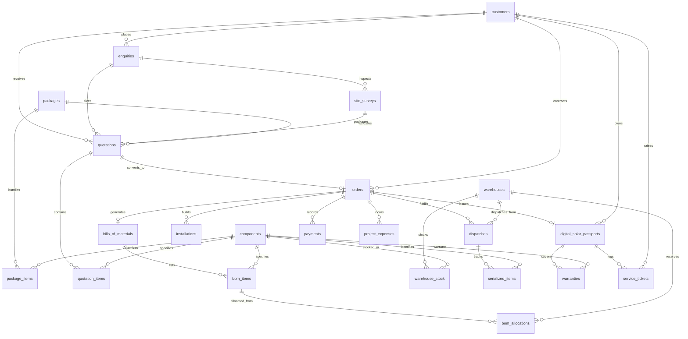

# SunPower Solutions – Database Schema Specification
## SQLite Relational Schema with Foreign-Key Enforcement (Stage 2)

Foreign key enforcement is strictly enabled on every SQLite database connection via:
```sql
PRAGMA foreign_keys = ON;
```

---

### Entity Relationship Diagram



---

### Key Tables & Constraints

#### 1. `customers`
- `id`: INTEGER PRIMARY KEY
- `uuid`: VARCHAR(36) UNIQUE NOT NULL INDEX
- `name`: VARCHAR(100) NOT NULL
- `phone`: VARCHAR(20) NOT NULL INDEX
- `email`: VARCHAR(120) NULLABLE
- `address`: TEXT NOT NULL
- `city`: VARCHAR(80) NOT NULL
- `state`: VARCHAR(80) NOT NULL DEFAULT 'Maharashtra'
- `pincode`: VARCHAR(10) NOT NULL
- `consumer_number`: VARCHAR(50) NULLABLE
- `avg_monthly_bill_paise`: INTEGER NOT NULL DEFAULT 0
- `sanctioned_load_kw`: FLOAT DEFAULT 0.0
- `created_at`: DATETIME NOT NULL

#### 2. `enquiries`
- `id`: INTEGER PRIMARY KEY
- `uuid`: VARCHAR(36) UNIQUE NOT NULL INDEX
- `customer_id`: INTEGER FK -> `customers.id` ON DELETE CASCADE
- `enquiry_number`: VARCHAR(30) UNIQUE NOT NULL INDEX
- `required_capacity_kw`: FLOAT NOT NULL
- `property_type`: VARCHAR(50) NOT NULL DEFAULT 'Residential'
- `roof_type`: VARCHAR(50) NOT NULL DEFAULT 'RCC Flat'
- `grid_type`: VARCHAR(30) NOT NULL DEFAULT 'ON_GRID' (ON_GRID, OFF_GRID, HYBRID)
- `budget_paise`: INTEGER NULLABLE
- `status`: VARCHAR(40) NOT NULL DEFAULT 'NEW' (`NEW`, `SURVEY_SCHEDULED`, `SURVEY_COMPLETED`, `QUOTED`, `ORDER_PLACED`, `REJECTED`)
- `notes`: TEXT NULLABLE
- `created_at`: DATETIME NOT NULL

#### 3. `site_surveys`
- `id`: INTEGER PRIMARY KEY
- `uuid`: VARCHAR(36) UNIQUE NOT NULL INDEX
- `enquiry_id`: INTEGER FK -> `enquiries.id` ON DELETE CASCADE
- `survey_number`: VARCHAR(30) UNIQUE NOT NULL INDEX
- `surveyor_name`: VARCHAR(100) NOT NULL
- `survey_date`: DATETIME NOT NULL
- `roof_area_sqft`: FLOAT NOT NULL
- `usable_roof_area_sqft`: FLOAT NOT NULL
- `roof_type`: VARCHAR(50) NOT NULL DEFAULT 'RCC Flat'
- `roof_azimuth_deg`: FLOAT DEFAULT 180.0
- `tilt_angle_deg`: FLOAT DEFAULT 15.0
- `shading_loss_pct`: FLOAT DEFAULT 5.0
- `structural_integrity`: VARCHAR(30) NOT NULL DEFAULT 'GOOD' (POOR, FAIR, GOOD, EXCELLENT)
- `recommended_capacity_kw`: FLOAT NOT NULL
- `structure_recommendation`: VARCHAR(100) DEFAULT 'Elevated Galvanized Structure'
- `meter_type`: VARCHAR(40) NOT NULL DEFAULT 'THREE_PHASE'
- `inverter_distance_meters`: FLOAT DEFAULT 12.0
- `notes`: TEXT NULLABLE
- `status`: VARCHAR(30) NOT NULL DEFAULT 'APPROVED' (`SCHEDULED`, `IN_PROGRESS`, `APPROVED`, `REJECTED`)
- `created_at`: DATETIME NOT NULL

#### 4. `quotations` & `quotation_items`
- `quotations.quotation_number`: VARCHAR(40) UNIQUE NOT NULL INDEX
- `quotations.survey_id`: FK -> `site_surveys.id` (Enforces approved survey requirement before creation)
- `quotations.package_id`: FK -> `packages.id` (Optional standard package link)
- `quotations.tax_amount_paise`: INTEGER DEFAULT 0
- `quotations.valid_until`: DATETIME NULLABLE
- `quotations.terms_and_conditions`: TEXT NULLABLE
- `quotations.status`: VARCHAR(30) DEFAULT 'DRAFT' (`DRAFT`, `SHARED`, `ACCEPTED`, `REJECTED`)
- `quotation_items.component_id`: INTEGER FK -> `components.id` NULLABLE (supports custom and service items)

#### 5. `orders`
- `order_number`: VARCHAR(40) UNIQUE NOT NULL INDEX
- `quotation_id`: INTEGER FK -> `quotations.id` UNIQUE NOT NULL (Guarantees duplicate order prevention per accepted quote)
- `customer_id`: INTEGER FK -> `customers.id` NOT NULL
- `total_contract_paise`: INTEGER NOT NULL (Equal to quotation net payable amount)
- `advance_required_paise`: INTEGER NOT NULL (20% standard booking milestone)
- `advance_received_paise`: INTEGER DEFAULT 0
- `stage`: VARCHAR(40) DEFAULT 'CONFIRMED'
- `payment_status`: VARCHAR(30) DEFAULT 'PARTIAL'
